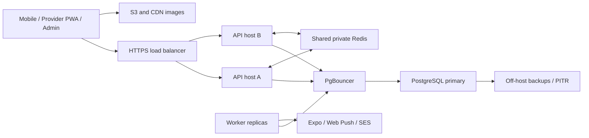

# Atlantic Express scaling roadmap — production facts, 12 October 2026

Reported production: one Contabo VPS, 4 vCPUs/8 GB RAM; one API, one dedicated
worker; PostgreSQL max_connections=100. PostgreSQL, Redis and application
containers share the same host. No measured production capacity or staging
stress-test result has been supplied. Registered users are not simultaneous
active users; request rate, query cost and storage growth determine capacity.

## 1. Set the connection budget now

In Coolify API environment:

    DB_MAX_CONNS=20
    DB_MIN_CONNS=1
    DATABASE_READ_URL=
    RUN_INLINE_WORKERS=false

In the dedicated worker environment:

    DB_MAX_CONNS=10
    DB_MIN_CONNS=1
    DATABASE_READ_URL=
    RUN_INLINE_WORKERS=false

Redeploy both after saving. Keep the direct primary DATABASE_URL for now.
Keep RUN_MIGRATIONS=true on the single direct-DB API unless a separate migration
job is already configured. The worker uses /Dockerfile.worker and needs no public
domain. This reserves at most 30 application connections, not one connection
per active chat user. These are recommended settings, not verified live values.

| API replicas | API pools | Worker pool | Total app connections | Slots remaining out of 100 |
|---|---:|---:|---:|---:|
| 1 | 20 | 10 | 30 | 70 |
| 2 | 40 | 10 | 50 | 50 |
| 3 | 60 | 10 | 70 | 30 |

Count other applications/databases, read pools, backups, psql and migrations too;
superuser-reserved slots are not app capacity. Keep at least 30 slots outside
the calculated app budget until measurements justify a different allocation.
Do not jump to max_connections=1000 on an 8-GB shared VPS. Extra connections do
not provide extra CPU, memory or disk throughput.

## 2. Launch preparation on the existing machine

User confirmed no off-server backups/restore test on 12 October. Follow
BACKUP_RESTORE_RUNBOOK.md before a database cutover or infrastructure split.

- Deploy the bounded/indexed chat changes and run the synthetic staging test in
  CHAT_LAUNCH_CAPACITY.md. Start at 20/50/100 active chats, then increase in tested
  steps. Do not run stress tests against paying customers.
- Keep authenticated history private. The service worker caches public assets
  only. Cache catalogue reads in Redis; store images in S3 and serve public
  images through the CDN, keeping image bandwidth off the API/DB.
- Require Redis for production distributed rate limiting/cache, with a private
  password-protected REDIS_URL and REDIS_OPTIONAL=false after confirming Redis
  connectivity/readiness. Set and monitor a Redis memory budget/eviction policy
  appropriate to this cache role; durable emails/push/payments remain in PG.
- Set container memory/CPU budgets after measuring resident usage. Reserve memory
  for PostgreSQL and the OS; avoid letting builds/image conversion crowd out DB.
  Build on CI/separate build capacity when builds cause resource contention.
- Confirm worker restart policy, health checks, queue age/failure alerts and disk
  space alerts. Set up off-host database backups with a restore drill; WAL/PITR
  where supported. A second disk/DB copy that has never been restored is not
  verified recovery. PostgreSQL autovacuum must remain enabled.

Use pool/queue-health and diagnose-capacity.sql plus host/container monitoring.
Suggested initial operational alerts below are policy starting points, not
measured server limits. Tune them from staging and normal traffic:

| Signal | Initial investigation trigger |
|---|---|
| User API response time | p95 above 500 ms for 10 minutes |
| Failed requests | unexpected 5xx above 1% over 5 minutes |
| Host CPU | above 70% for 10 minutes during normal traffic |
| Host memory | available RAM below 1.5 GB or sustained swapping |
| PostgreSQL pool | sustained exhausted-pool waits/cancellations |
| Worker deliveries | oldest pending push above 30–60 seconds and increasing |
| Disk/WAL/backups | space above 70%, growing backlog or missed backup |

## 3. First split: dedicated database, then another application host

For a launch expected to drive a large advertising surge, plan the database
split before that surge rather than waiting for failures. Prefer a managed PG
service with verified backups/PITR and failover, or a dedicated PG host with
equivalent operations. Put it close to the application host with private
networking/TLS. A planning baseline could be 4 vCPUs, 8–16 GB RAM and NVMe SSD;
size it from working-set memory, write rate, I/O latency and backup needs, not a
promise that this hardware supports a particular user count.

Choose separation when DB CPU/I/O is the bottleneck, backups/vacuum/builds compete
with API/worker CPU, memory pressure persists, or one-host outage risk is no
longer acceptable. If measurements show the API is CPU-bound and the DB is
healthy, add an app host instead. A temporary larger VPS can provide headroom,
but still leaves API, DB, Redis and queues in one failure domain. There is no
defensible single registered-user threshold for this decision.

Migration sequence: provision and restore a staging copy; test authentication,
orders/payment webhooks, chats, support and worker queues; compare counts and
verify restore/rollback; perform a controlled primary cutover; point API+worker
to the same new primary and direct migration URL. Use a documented replication
or brief write-freeze cutover strategy to prevent missing/double-written orders.
Do not create a second unrelated production database and split user accounts
between it and the first. All replicas share the same authoritative primary.

After DB isolation, add a second app host and distribute API replicas behind
one HTTPS load balancer. Multiple containers on the original VPS cannot survive
that VPS failing. Keep Redis shared/private so cache/rate limits work across
replicas. Workers scale separately using durable SKIP LOCKED queues. Account
JWT signing secrets and provider policy/config must match across API replicas.

## 4. PgBouncer after staging acceptance

The existing pgx app pools already bound connections. PgBouncer is useful as
process/host counts grow; it multiplexes transactions, not application users,
and does not eliminate query work. Use transaction mode on a private port, with
TLS and matching SCRAM credentials. A starting server budget could be 25 regular
+5 reserve per user/database pair and a 60-connection database-wide ceiling,
subject to staging measurements. max_client_conn=500 means proxy client
connections, not 500 PostgreSQL processes.
Multiple proxies each have their own budget: account for their combined totals.

The launch release keeps the existing direct pgx pools. A trial of uncached
extended-query mode failed several isolated payment/support tests because
query parameter encoding differed. That optional mode was removed; do not
switch production to transaction pooling as part of this release. A later
PgBouncer rollout must validate prepared-statement support and all parameter
types through the actual proxy, including payments, support and chat.

When that rollout passes staging, point API/worker DATABASE_URL to the proxy,
keep MIGRATION_DATABASE_URL pointing DIRECTLY to PG, set RUN_MIGRATIONS=false
on APIs, and run /app/across-migrate separately before rollouts. Do not route
session-scoped migration locks through transaction pooling. Test the real
proxy's TLS/authentication/connection reuse before changing production URLs.

## 5. Larger scale

Replace frequent foreground polling with authenticated live message events
(WebSocket/SSE), cross-host routing/pub-sub and reconnect/catch-up cursors.
Persist each message before publishing the event; use private client caches for
display and PG for history. Redis pub/sub alone is not durable message history.
Our current implementation still polls foreground chats; it does not already
provide this live transport. WhatsApp documents clients connecting to messaging
servers through its XMPP-based protocol, rather than a DB connection per phone.

Add a standby/failover strategy for PG; read replicas only for explicitly
lag-tolerant analytics/catalogue routes. Keep payments, inventory and immediate
chat reads on the primary. Plan retention/archival of operational receipts and
large chat tables with measurements and an agreed policy. Partition/shard only
when a measured primary/storage bottleneck warrants the complexity. A million
registered users does not itself require sharding, and these code changes do
not certify a million simultaneous users.

Sources: https://www.pgbouncer.org/config.html
https://www.postgresql.org/docs/16/runtime-config-connection.html
https://www.postgresql.org/docs/16/monitoring-stats.html
https://pkg.go.dev/github.com/jackc/pgx/v5#QueryExecMode
https://engineering.fb.com/2024/03/06/security/whatsapp-messenger-messaging-interoperability-eu/
